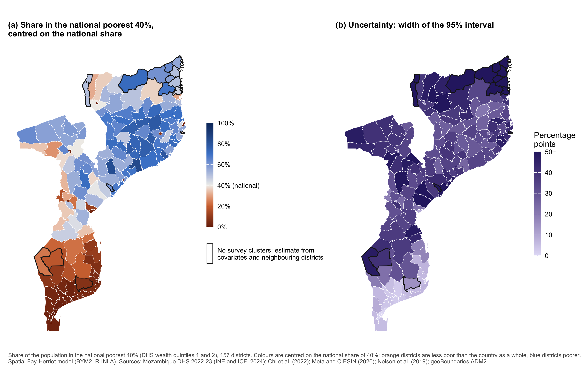
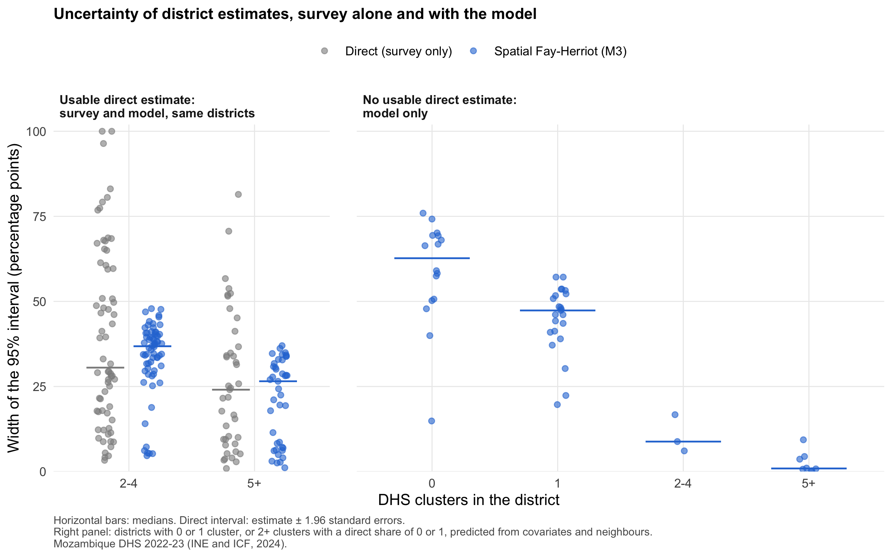
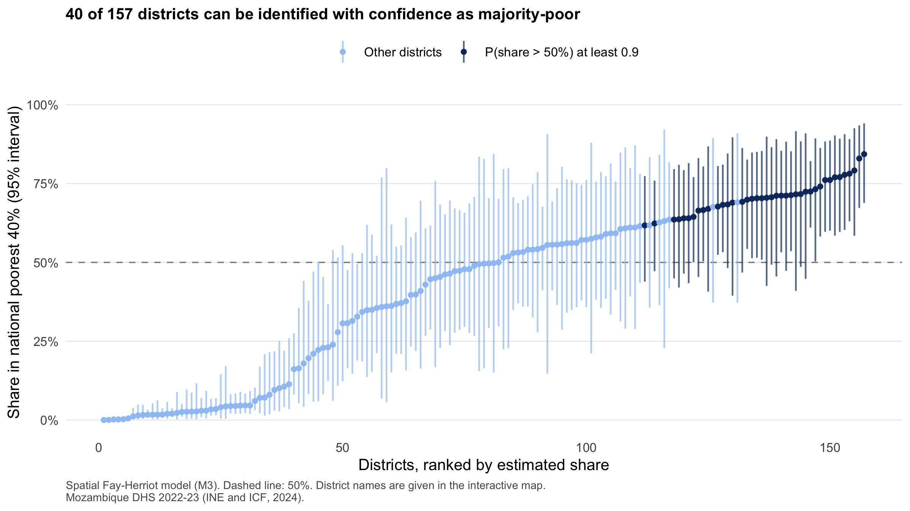
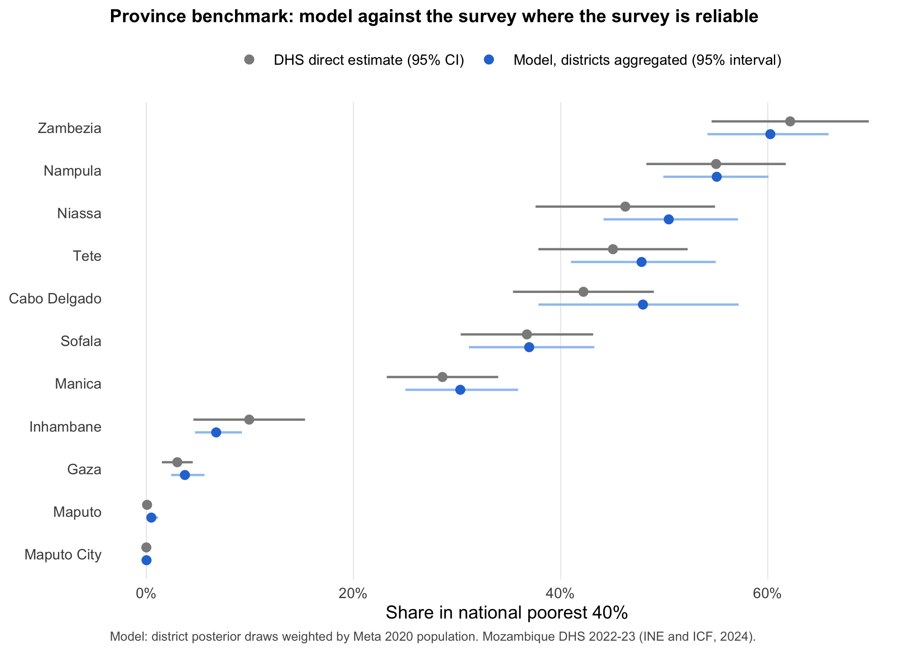
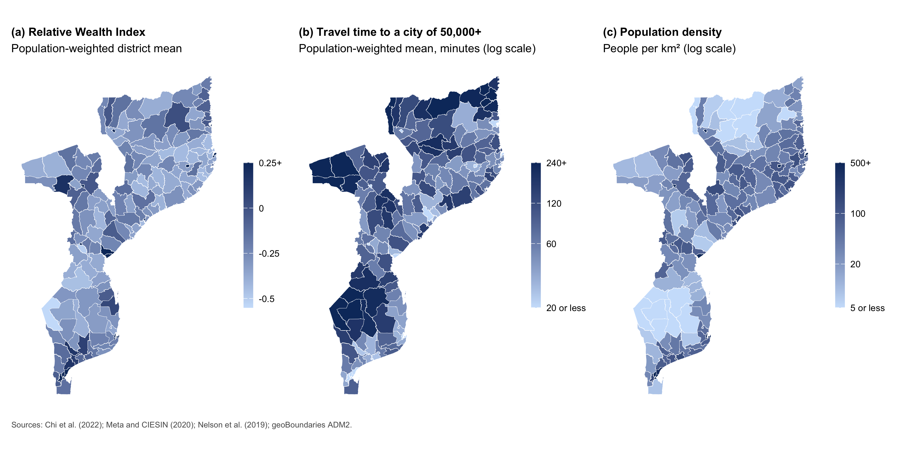

# District poverty in Mozambique: small area estimates from the DHS and open geospatial data

**[Interactive map](https://USERNAME.github.io/mozambique_sae/)** · Peter Hargreaves · [results table](output/s03_district_estimates.csv)



Large, sparsely populated districts dominate the map visually; the [interactive map](https://USERNAME.github.io/mozambique_sae/), which gives each district's population, and the population figures under Key results give a fairer sense of where people live.

The Mozambique Demographic and Health Survey (DHS) 2022-23 is designed to give reliable estimates for the country's 11 provinces, yet many policy decisions, from budget allocation to the targeting of social protection, are made at district level. With a median of three survey clusters in each sampled district, and none at all in 16 of 157 districts, the survey alone cannot support district estimates. This project combines the DHS with open geospatial data in small area estimation (SAE) models to estimate, for every district, the share of the population living in households in the national poorest 40%, together with a measure of how certain each estimate is.

## Key results

- **An estimate for every district.** The survey supports a usable direct estimate in 107 of 157 districts; the model provides estimates, with 95% intervals, for all 157, including the 50 with no clusters, a single cluster, or a direct share of exactly 0.
- **A clear north–south divide.** The share of the population in the national poorest 40% exceeds 60% in many districts of Zambézia, Nampula, Niassa, and Cabo Delgado, and is below 10% in most districts of Gaza, Inhambane, and Maputo province. In 40 districts, all in the centre and north, the posterior probability that more than half the population is in the national poorest 40% is at least 0.9 (Figure 3).
- **Where the poorest live.** These 40 districts are home to 8.4 million people, 27% of the national population (Meta and CIESIN, 2020), of whom an estimated 5.9 million (95% interval 5.5 to 6.2 million) are in the national poorest 40%.
- **Reliable rather than narrower intervals.** With two to four clusters, a district's own standard error is a poor guide to its uncertainty: a quarter of the district design effects are below 0.7, against a pooled value of 6.5, so many survey-only intervals are far too narrow, while others span most of the possible range (Figure 2). The model's intervals are of similar median width (37 against 31 percentage points for districts with two to four clusters; 27 against 24 for five or more) but far more consistent, and in simulation they covered the true share in 92% of districts on average, against 84% for the survey alone.
- **Agreement with the survey where it is reliable.** Aggregated to provinces, the district estimates fall within the 95% confidence interval of the survey's own province estimates in 9 of 11 provinces (Figure 4). The two exceptions are Maputo province and Maputo City, where both estimates are below 1%.
- **Uncertainty is greatest where the survey is thinnest**, above all in Cabo Delgado, where 9 of the province's 17 districts have no survey clusters and their estimates rest on covariates and neighbouring districts alone (Figure 1b).

| | Survey alone | Spatial Fay-Herriot (M3) |
|---|---|---|
| Districts with an estimate | 107 of 157 | 157 of 157 |
| Median 95% interval width, districts with 2–4 clusters (66) | 30.5 points | 36.8 points |
| Median 95% interval width, districts with 5+ clusters (41) | 24.1 points | 26.5 points |
| 95% interval coverage in simulation (20 synthetic surveys) | 84% | 92% |





## Approach

1. **Direct estimates** (`R/01_direct.R`). Design-based estimates by district with the `survey` package, using DHS clusters, strata, and person weights (hv005 × hv012). DHS cluster displacement is restricted to the district (admin2), so each cluster is assigned to its true district.
2. **Covariates** (`R/02_covariates.R`). For every district: the population-weighted mean Relative Wealth Index (Chi et al., 2022), population-weighted travel time to the nearest city of 50,000 or more (Nelson et al., 2019), and population density (Meta and CIESIN, 2020).
3. **Models** (`R/03_models_inla.R`). Fay-Herriot models on the logit scale in R-INLA, with sampling variances smoothed by a generalised variance function (see Model checks): an IID model without covariates, a Bayesian Fay-Herriot with covariates, a spatial Fay-Herriot with a BYM2 district effect (the main model, M3), and BYM2 smoothing alone. Penalised complexity priors. The models are compared by DIC, WAIC, and the leave-one-district-out log score (CPO), with PIT checks. Districts without usable direct estimates are predicted from their covariates and neighbours.
4. **Frequentist cross-check** (`R/04_fh_emdi.R`). A standard Fay-Herriot model (REML) with the arcsine transformation and bootstrap MSE (`emdi`), as used in official SAE poverty maps.
5. **Validation and figures** (`R/05_outputs.R`). Posterior draws for the districts are aggregated to provinces with population weights and compared with the DHS direct province estimates.
6. **Interactive map** (`R/06_web.R`). A Leaflet map published with GitHub Pages from `docs/`.



### Model checks

| Model | Linking model | DIC | WAIC | Log score (CPO) | PIT outside 0.05–0.95 |
|---|---|---|---|---|---|
| M1 | IID, no covariates | 305.7 | 289.8 | 1.98 | 0.10 |
| M2 | Covariates + IID (Fay-Herriot) | 295.8 | 280.2 | 1.82 | 0.10 |
| **M3** | **Covariates + BYM2 (spatial Fay-Herriot)** | **265.9** | **263.9** | **1.34** | **0.09** |
| M4 | BYM2, no covariates | 288.4 | 288.2 | 1.53 | 0.13 |

M3 is preferred on every criterion, with no CPO failures. Its BYM2 mixing parameter is 0.86 (95% interval 0.61 to 0.98), so most of the variation between districts not explained by the covariates is spatially structured, which is why the spatial models outperform M2 by a wide margin. The covariates are strongly correlated with each other and with the spatial pattern (for example, r = −0.81 between the Relative Wealth Index and travel time), so their individual coefficients are not interpreted; only the Relative Wealth Index has an interval clear of zero in M3. The frequentist Fay-Herriot (`emdi`) agrees closely with its Bayesian counterpart M2 (correlation 0.998 in sample, 0.988 out of sample); it agrees less with M3 out of sample (0.75), as expected, since only M3 borrows strength from neighbouring districts.

**Sampling variances.** A Fay-Herriot model treats each district's sampling variance as known, but most districts have only two or three DHS clusters, so their direct variances are themselves very uncertain. A district whose variance happens to be underestimated is trusted too much, and its interval is too narrow. The models therefore use smoothed variances from a design-effect generalised variance function (Corral et al., 2022): a pooled design effect (the mean of the district design effects, weighted by their degrees of freedom) times the binomial variance at a stabilised share, which is a leave-one-out prediction from the covariates that does not use the district's own estimate. The pooled design effect for the DHS is 6.5, with district values ranging from below 0.01 to 37.5 (median 2.75; `output/s03_design_effects.csv`). The choice was tested on 20 synthetic surveys drawn on the real districts and covariates (`R/sim_variance_study.R`). With direct variances, the 95% intervals of the main model covered the true district share in 87% of sampled districts on average; with smoothed variances, 93%, about as high as with the true variances (94%). Error fell by 8% (RMSE 0.068 against 0.074), and coverage rose in 19 of the 20 surveys. The remaining shortfall from 95% is present even with the true variances, so it does not come from the variances. Direct variances remain available (`MOZSAE_VAR=direct`). A variant that also admits districts with a single cluster (`MOZSAE_VAR=smoothed1`) did slightly better again in the simulation (coverage 93%, RMSE 0.092 against 0.101 for districts without a usable direct estimate), but it changes which districts enter the model and is not the default.

### Covariates



### Deviations

Changes considered after the first run on the real data (16 November 2026):

- **Districts with a direct share of exactly 0.** Eleven districts with two or more DHS clusters had no household in the national poorest 40% in the sample (a direct share of 0 and no direct variance), mostly in Maputo and Maputo City. The rule fixed before the real run predicts these districts out of sample, from their covariates and neighbours, and the main model then placed Maputo province above its direct interval in the province benchmark. Admitting them to the likelihood with the empirical logit, logit((x + 0.5) / (n<sub>eff</sub> + 1)) with n<sub>eff</sub> = households / pooled design effect and the smoothed variance (`MOZSAE_ZERO=include`), was tested on the same 20 synthetic surveys before it was run on the real data (`R/sim_variance_study.R`, studies `zero` and `zero_plasmode`). In the base simulation such districts are rare (1.6 per survey); in a second scenario whose true shares are the main model's estimates from the first real run (8.1 per survey), the empirical logit lowered the error of the main model for these districts (RMSE 0.013 against 0.019) but its 95% intervals covered the true share in only 78% of them, against 97% when they are excluded: the 0.5 added to the count pulls the estimates up, and the intervals are too narrow to allow for it. Over all districts, RMSE was unchanged (0.064 against 0.063). Because the change harmed coverage for the districts it targets, the original rule was kept, and the empirical logit is reported as a sensitivity (`Rscript R/sens_real.R MOZSAE_ZERO=include`; results in `data_work/sensitivity/`). On the real data the empirical logit moved the Maputo province estimate further from its direct estimate, not closer (0.0096 against 0.0048; direct 0.0007), and left Gaza almost unchanged (0.038 against 0.037; direct 0.030).
- **Province of each district.** Districts are assigned to provinces by the province of most of their DHS households (hv024), and by GADM boundaries only for districts without clusters. GADM placed Cidade da Matola in Maputo City; this was found when the province assignments were checked against the DHS in the first real run, and corrected.

## How the estimates should be used

District estimates such as these are best suited to allocating resources between areas, with their uncertainty stated. They are not a substitute for identifying poor households: in related work, I find that even a perfectly accurate area-level map would miss a substantial share of the poorest households in rural Mozambique, because much of the variation in wellbeing lies within villages and districts rather than between them (Hargreaves, in preparation).

## Running

Open `mozambique_sae.Rproj` in RStudio, so that the working directory is the project root, then:

```r
source("R/00_setup.R")   # once: renv library; INLA from its own repository
```
```sh
Rscript run_all.R
```

Sensitivity runs with a switch away from its default (for example `Rscript R/sens_real.R MOZSAE_ZERO=include`) write only to `data_work/sensitivity/`. Inputs are read in place from another project: set `MOZSAE_PAPER_A` to the folder holding `data_raw/external/` (see `R/functions.R`).

## Data

The DHS data are not included and may not be redistributed. Register with the [DHS Program](https://dhsprogram.com) to obtain the Mozambique 2022-23 household recode (MZHR82) and GPS file (MZGE81). Household-level files, cluster-level files, and direct district estimates are written to `data_work/`, which is excluded from version control. `output/` and `docs/` hold district-level model estimates, covariates from public data, and figures only. No cluster location is shown anywhere.

Districts are the 159 geoBoundaries ADM2 units, less two islands in Lake Niassa that belong to Malawi (Likoma and Chizumulu), leaving 157.

## Limitations

- An area-level model only. A unit-level model (for example, empirical best prediction with household covariates) would need census microdata, which are not publicly available.
- The DHS wealth index is a relative asset measure, not consumption poverty.
- Covariates are means over whole districts, whereas DHS clusters are a sample within them.
- No census benchmark is available, so validation relies on internal checks (CPO, PIT), simulation, and agreement with the province direct estimates.
- Sixteen districts have no survey clusters, nine of them in Cabo Delgado. Their estimates rest on covariates and neighbouring districts; if they were left unsampled for reasons related to their circumstances (for example insecurity), they may differ from their neighbours in ways the model cannot capture.

## References

- Chi, G., Fang, H., Chatterjee, S. and Blumenstock, J.E. (2022). Microestimates of wealth for all low- and middle-income countries. *PNAS*, 119(3), e2113658119.
- Corral, P., Molina, I., Cojocaru, A. and Segovia, S. (2022). *Guidelines to Small Area Estimation for Poverty Mapping*. World Bank.
- Fay, R.E. and Herriot, R.A. (1979). Estimates of income for small places: an application of James-Stein procedures to census data. *Journal of the American Statistical Association*, 74(366), 269–277.
- INE and ICF (2024). *Moçambique Inquérito Demográfico e de Saúde 2022-23*. Maputo and Rockville, MD.
- Nelson, A. et al. (2019). A suite of global accessibility indicators. *Scientific Data*, 6, 266.
- Riebler, A., Sørbye, S.H., Simpson, D. and Rue, H. (2016). An intuitive Bayesian spatial model for disease mapping that accounts for scaling. *Statistical Methods in Medical Research*, 25(4), 1145–1165.
